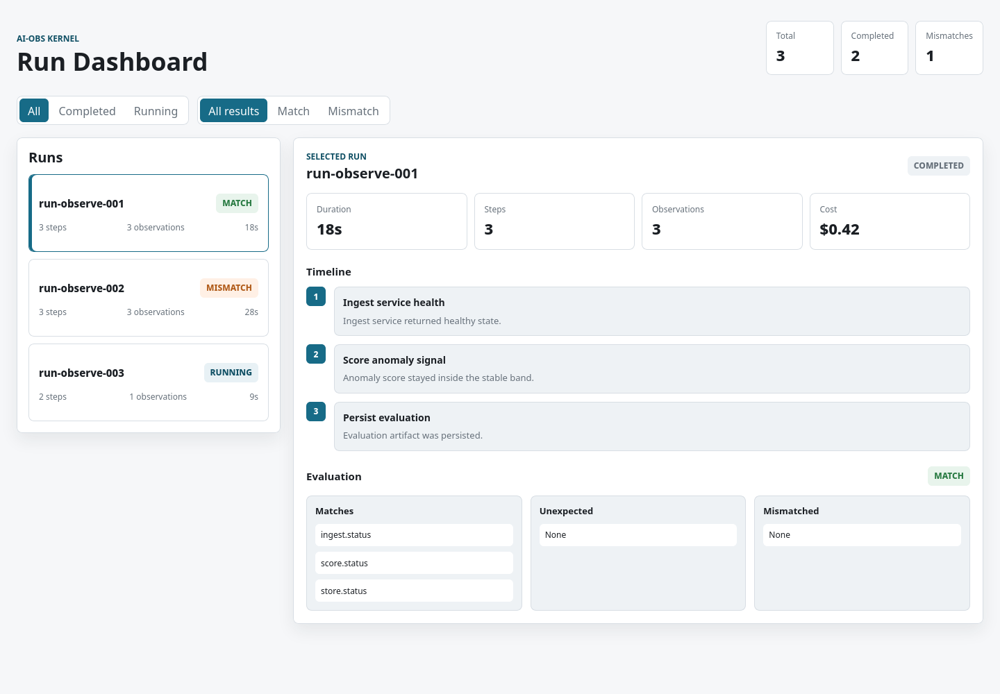

# AI-Obs

**Make the gap between an AI system's reported outcome and external evidence observable.**

A run can complete without errors while its outcome falls short. AI-Obs explores
how to expose that gap: compare what the system believes happened with what
qualified external evidence says happened, then report drift and behavioral
stability alongside operational run data.

**Status: Technical Preview.** This is a showcase prototype with deterministic,
simulated demos. The Python evaluators and operational tools are implemented;
a real evidence collection and qualification pipeline is still planned.
Evaluation outputs are informational and never trigger corrective action.

[Quick start](#quick-start) · [Concepts](#what-ai-obs-measures) ·
[Demos](#demo) · [Current status](#current-status) · [Documentation](#documentation)

## Quick Start

Use Python 3.11, the version used in CI. The commands below use a POSIX shell
and run from the repository root after cloning.

```bash
git clone https://github.com/P3niel/ai-obs.git
cd ai-obs
python3 -m venv .venv
.venv/bin/python -m pip install -r backend/requirements.txt
.venv/bin/python backend/kernel_output_demo.py
```

The main demo runs seven simulated belief-versus-reality scenarios through the
passive drift evaluator, M3 evaluator, and Kernel output assembler. Three examples:

| Simulated outcome | M1 | M2 | Drift | Stability | Status |
| --- | --- | --- | --- | --- | --- |
| Belief close to reality, consistent behavior | 1 | 0.95 | 0.05 | 0.95 | `healthy` |
| Belief overshoots reality | 0.8 | 1 | 0.2 | 0.8 | `warning` |
| Belief far from reality | 0 | 1 | 1 | 0 | `critical` |

Other scenarios show insufficient comparable runs, inconsistent behavior, and
incompatible system versions. Add `--json` for the full structured output.

The only runtime dependency is `rfc8785==0.1.4`, used by M3 for canonical JSON.
The operational demo and static dashboard can run without installing it.

## What AI-Obs Measures

AI-Obs has two complementary parts: passive outcome evaluation and operational
run inspection. They use separate inputs and are demonstrated independently.

### Outcome gap and behavioral stability

| Signal | Meaning | Current implementation |
| --- | --- | --- |
| **M1 — observed outcome** | What qualified external evidence says happened | A producer emits a binary observation from already-resolved qualification and evidence facts, or abstains with a reason. The drift evaluator also accepts caller-supplied scores in `[0, 1]`. |
| **M2 — represented outcome** | What the system believes happened | A caller-supplied score in `[0, 1]`; there is no M2 producer yet. |
| **D — drift magnitude** | How far M1 and M2 differ | `D = abs(M1 - M2)`, computed only for comparable inputs. |
| **M3 — behavioral stability** | How consistently comparable runs follow the same event structure | The share matching the most frequent event sequence, using up to 50 recent eligible runs and requiring at least 10. It measures structure, not answer correctness. |

M1 and M2 must refer to the same run, target, system version, and observation
window. Unusable evidence causes the M1 producer to abstain; non-comparable or
unusable signals yield a non-evaluable drift result with reasons.

The passive drift evaluator attaches no threshold or alert to `D`. A separate
[Kernel output assembler](backend/app/kernel_output.py) combines drift and M3
into `{drift, bias, stability, status}`:

- `bias` equals `D` in this preview; it is not a separate statistical bias estimate.
- `stability = M3 - D` when the inputs are evaluable and comparable.
- `critical` applies at `D >= 0.30`; `warning` at `0.10 <= D < 0.30`.
- `healthy` requires `D < 0.10` and available stability greater than `0.50`.
- Remaining cases are `unclassified`, with reasons.

The assembler marks its output `authoritative: false`. These rules describe this
prototype's contract; they are not validated guarantees about an AI system.

### Operational run inspection

The in-memory Kernel records expected and observed key/value states and computes
a deterministic `MATCH` or `MISMATCH`, including missing, unexpected, and
mismatched keys. Operational helpers read those run payloads:

```text
Caller-supplied run data (synthetic events in the demo)
    → In-memory Kernel → Run payloads
                            ├─ Metrics → Threshold alerts → Console / webhooks
                            ├─ Read-only timeline replay
                            └─ Two-run comparison
```

The static dashboard is an independent viewer over embedded example payloads.
It does not consume live backend data or display the outcome-gap evaluations.

For the rationale and worked examples, read [Concepts](docs/concepts.md).
For contracts and boundaries, see [Architecture](docs/architecture.md) and the
[Python API](docs/api.md).

## Demo

After the quick-start setup, run any terminal demo from the repository root:

| Demo | Command | What it shows |
| --- | --- | --- |
| Belief versus reality | `.venv/bin/python backend/kernel_output_demo.py` | Seven simulated scenarios with drift, stability, and health status. Supports `--json`. |
| Drift and stability | `.venv/bin/python backend/m2_demo.py` | Nine synthetic scenarios covering M1 production, abstention, comparability, drift, and M3. Supports `--json`. |
| Operational pipeline | `.venv/bin/python backend/run_demo.py` | Synthetic `MODEL_CALL` events flowing through the Kernel, metrics, detection, and console. Supports `--verbose`. |

The operational demo also runs directly with
`python3 backend/run_demo.py`, with no external dependencies or network access.

To explore example runs in the static dashboard:

```bash
python3 -m http.server 8000 --bind 127.0.0.1
```

Open [the local Run Explorer](http://127.0.0.1:8000/frontend/dashboard.html).
It supports run filtering, timelines, error/mismatch highlighting, and evaluation
deltas. No backend process or frontend build is required.



See the [demo guide](docs/demo.md) for walkthroughs and expected results.

## Current Status

### Implemented

| Capability | Source |
| --- | --- |
| In-memory run recording and expected/observed evaluation | [Kernel](backend/app/kernel.py) |
| Run counts, latency and duration summaries, step durations, evaluation counts and mismatch rate | [Operational observability](backend/app/operational_observability.py), [latency analytics](backend/app/latency_analytics.py) |
| Fixed rules for slow runs/steps, stuck runs, errored steps, and evaluation failures | [Alert detection](backend/app/operational_observability.py), [anomaly report facade](backend/app/run_anomaly_detection.py) |
| Slack/Discord message formatting and configured webhook dispatch | [Alert dispatch](backend/app/alert_dispatch.py) |
| Immutable timeline replay and two-run comparison of noise versus material differences | [Replay](backend/app/replay.py), [comparison](backend/app/run_comparison.py) |
| Canonical status/metric mapping and a versioned `run.count` handoff artifact | [Canonical mapping](backend/app/canonical_mapping.py), [metrics/detection handoff](backend/app/metrics_detection_handoff.py) |
| Qualified M1 production, passive M1/M2 drift, M3 evaluation, and Kernel output assembly | [M1 producer](backend/app/m1_observation_producer.py), [drift evaluator](backend/app/passive_drift_evaluation.py), [M3 evaluator](backend/app/m3_behavioral_stability.py), [output assembler](backend/app/kernel_output.py) |
| Static Run Explorer over embedded example data | [Dashboard](frontend/dashboard.html) |

### Limits of the preview

- The backend exposes an in-process Python API. It has no HTTP API, database,
  durable storage, or authentication layer.
- The outcome evaluators rely on caller-supplied inputs. Evidence collection,
  qualification, qualification storage, M2 production, and M3 record production
  are not implemented. The demos supply simulated inputs.
- Replay reconstructs recorded data; it does not re-execute models or tools.
- Operational detection uses fixed rules. Statistical anomaly detection,
  p95 metrics, token counting, and cost calculation are not implemented.
  Any cost shown in the dashboard is supplied metadata.
- The versioned metrics/detection handoff covers `run.count` only.
- The project does not perform autonomous correction, retraining, weight
  adjustment, or rollback. Hosted and multi-tenant deployment are out of scope.

## Roadmap

Planned directions, without delivery commitments:

- Build a real input pipeline for outcome evaluation: evidence collection and
  qualification, a qualification store, an M2 producer with authoritative target
  and system-version metadata, and M3 run-record production.
- Connect the dashboard to live detection output.
- Add durable persistence and an HTTP API.
- Extend evaluation beyond flat key/value states and broaden the event model.
- Add cost/token metrics, percentile durations, baseline comparisons, and
  statistical or learned anomaly detection.

## Development

Install the development tools into the quick-start environment:

```bash
.venv/bin/python -m pip install -r backend/requirements-dev.txt
```

Run the same checks as [CI](.github/workflows/ci.yml) from the repository root:

```bash
.venv/bin/flake8 backend
.venv/bin/mypy backend/app backend/run_demo.py backend/m2_demo.py backend/kernel_output_demo.py
(cd backend && ../.venv/bin/pytest -q)
.venv/bin/bandit -r backend
```

For bug reports, documentation corrections, and small fixes, see
[Contributing](CONTRIBUTING.md). This is a solo-maintained showcase project;
discuss larger changes in an issue first.

## Documentation

- [Concepts](docs/concepts.md) — signals, rationale, and worked examples
- [Architecture](docs/architecture.md) — runtime responsibilities and boundaries
- [Python API](docs/api.md) — module interfaces and configuration
- [Metrics](docs/metrics.md) — computed fields and their sources
- [Detection](docs/detection.md) — alert rules and thresholds
- [Event & run schema](docs/event-schema.md) — current data shapes
- [Demo guide](docs/demo.md) — walkthroughs and expected output

## License and Security

Licensed under [Apache License 2.0](LICENSE).
See [SECURITY.md](SECURITY.md) for vulnerability reporting and security scope.
